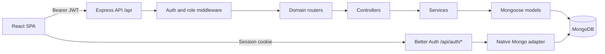

# Flyx — Private Jet Travel Platform (Backend)

A TypeScript/Express REST API for the Flyx shared private-charter membership platform. It handles authentication, travel demand, shared flight opportunities, custom travel requests, reservations, dashboards, analytics, and admin/staff management.

> Project status: in development. The API is functional, but payment, real-time notifications, and automated tests are not implemented yet.

## Project Description

Flyx is a private aviation membership platform that lets members share charter flights on popular routes. Instead of one traveler paying the full charter cost, multiple members heading in the same direction can join a shared opportunity and split the cost.

This repository is the backend service. It exposes a JSON REST API under `/api`, verifies Better Auth JWTs, enforces role-based permissions, and stores application data in MongoDB.

## Project Overview

Private jet travel is expensive for an individual traveler. Flyx addresses that by collecting member travel preferences, identifying demand on routes and dates, and letting staff publish shared charter opportunities. Members reserve seats, staff confirm trips, and administrators monitor platform activity.

The backend is organized around these domains:

| Domain | Responsibility |
| --- | --- |
| Authentication | Better Auth email/password accounts, sessions, JWT issuance, and JWKS |
| Users | Member directory, profile editing, staff account creation and deletion |
| Travel preferences | Recurring and one-time travel demand submitted by members |
| Custom travel requests | Detailed charter requests with passenger manifests and calendar demand |
| Opportunities | Shared charter inventory, seat reservations, and status lifecycle |
| Dashboard | Member-level stats, demand insights, and upcoming trips |
| Analytics | Staff insights and annual admin overview metrics |
| Health | Service health check |

The API supports three roles:

| Role | Capabilities |
| --- | --- |
| `user` | Submit preferences and custom requests, browse opportunities, reserve and cancel seats, view own trips |
| `staff` | Manage travel demand, custom requests, opportunities, and staff analytics |
| `admin` | Everything staff can do plus member management, staff management, and the admin overview |

## Live Demo

A public deployment URL is not committed in this repository. The backend is prepared for deployment on Vercel (the workspace contains Vercel project metadata for `flyx-travel-platform-backend`).

| Environment | URL |
| --- | --- |
| Local API | `http://localhost:5000` |
| Local API base | `http://localhost:5000/api` |
| Health check | `http://localhost:5000/api/health` |
| Production | Not published in the repository yet |

When deploying, set `BETTER_AUTH_URL` to the public backend origin and `CLIENT_URL` to the public frontend origin.

## Screenshots / Preview

This is an API-only service, so there is no application UI screenshot in this repository. The frontend preview is documented in [`../frontend/README.md`](../frontend/README.md).

Preview the health endpoint:

```bash
curl http://localhost:5000/api/health
```

```json
{
  "success": true,
  "message": "Server is running successfully"
}
```

Typical paginated API responses follow this shape:

```json
{
  "success": true,
  "data": [],
  "meta": {
    "page": 1,
    "limit": 8,
    "total": 0,
    "totalPages": 0,
    "hasNextPage": false,
    "hasPrevPage": false
  }
}
```

## Key Features

- Email/password authentication through Better Auth, with a JWT plugin and remote JWKS verification.
- Bearer-token middleware that validates issuer, audience, and expiry with `jose`.
- Role-based authorization for `user`, `staff`, and `admin`.
- MongoDB access through both the native driver (for Better Auth) and Mongoose (for domain models).
- Shared opportunity inventory with an atomic seat-reservation flow that prevents overbooking and duplicate reservations.
- Opportunity lifecycle management with explicit status transitions.
- Recurring and one-time travel preference collection with route and status filters.
- Custom travel requests with one-way/round-trip support, passenger manifests, and validation limits.
- Staff demand calendar that aggregates interested members and directions by day.
- Member dashboard with summary stats, high-demand routes, popular dates, and upcoming trips.
- Staff insights and annual admin analytics, including members over time and daily activity.
- Admin member directory editing and staff account provisioning/deletion.
- Pagination, filtering, consistent JSON response envelopes, and structured service errors.
- Centralized `/api` router and CORS restricted to the configured frontend origin.
- TypeScript strict mode with explicit ESM `.js` import paths.

## Technologies Used

| Technology | Version / Role |
| --- | --- |
| Node.js | JavaScript runtime (ESM) |
| TypeScript | `^5.9.3`, target ES2022, strict mode |
| Express | `^5.3.0`, HTTP server and routing |
| Better Auth | `^1.7.26`, authentication and session management |
| `@better-auth/mongo-adapter` | `^1.7.26`, Better Auth MongoDB adapter |
| JWT / JWKS | `jose` `^6.2.18` |
| MongoDB | `mongodb` `^7.9.0`, native driver |
| Mongoose | `^9.12.2`, schemas and domain models |
| CORS | `cors` `^2.8.6` |
| Environment loading | `dotenv` `^18.0.10` |
| Development runner | `tsx` `^4.23.15` |

## Project Architecture

The API uses a route → controller → service → model layering:



Request flow:

1. `src/server.ts` loads environment variables, connects to MongoDB, and starts Express.
2. `src/app.ts` applies CORS, mounts Better Auth on `/api/auth/*`, mounts the JSON body parser, and mounts the central `/api` router.
3. The central router delegates to domain routers such as `/api/opportunities`, `/api/travel`, `/api/custom-travel`, `/api/analytics`, `/api/dashboard`, `/api/users`, and `/api/health`.
4. `requireAuth` extracts the Bearer token, verifies it against Better Auth's JWKS endpoint, and stores the authenticated user in `res.locals.user`.
5. `requireRole` protects admin-only routes. Several services also re-check staff/admin access before performing manage operations.
6. Controllers validate and shape requests, then call services.
7. Services implement business rules and use Mongoose models.
8. Errors are returned as `{ "success": false, "message": "..." }`.

Database collections used by the application include:

- `user`, `session`, and `account` — Better Auth collections.
- `opportunities` — shared charter inventory and reservation user IDs.
- `travelpreferences` — recurring and one-time travel demand.
- `customtravelrequests` — detailed custom charter requests and passengers.

The server also configures public DNS resolvers (`1.1.1.1` and `8.8.8.8`) at startup to support MongoDB Atlas SRV resolution in the deployment environment.

## Project Structure

```text
Backend/
├── src/
│   ├── app.ts                         # Express app, CORS, Better Auth, API router
│   ├── server.ts                      # Environment setup, DB connections, HTTP listener
│   ├── router.ts                      # Central /api router
│   ├── config/
│   │   ├── auth.ts                    # Better Auth config, JWT plugin, user fields
│   │   ├── db.ts                      # Native MongoDB client and connectDB()
│   │   └── mongoose.ts                # Mongoose connection helper
│   ├── middlewares/
│   │   ├── auth.middleware.ts         # Bearer JWT verification through JWKS
│   │   └── role.middleware.ts         # requireRole(...roles)
│   ├── modules/
│   │   ├── analytics/                 # Staff insights and admin overview
│   │   ├── custom-travel-request/     # Custom requests, passengers, calendar
│   │   ├── dashboard/                 # Member dashboard overview
│   │   ├── health/                    # Health check
│   │   ├── opportunity/               # Shared opportunities and reservations
│   │   ├── travel-preference/         # Recurring and one-time travel demand
│   │   └── user/                      # Members and staff management
│   └── utils/
│       ├── member-lookup.util.ts      # Attach Better Auth member name/email to records
│       └── service-error.util.ts      # Shared ServiceError type
├── dist/                              # TypeScript build output (generated)
├── package.json
├── package-lock.json
├── tsconfig.json
└── README.md
```

Each domain module generally contains a router, controller, service, model, and types file.

## Installation & Setup

### Prerequisites

- Node.js 20 or newer (ESM and modern TypeScript support recommended).
- npm.
- A MongoDB database: MongoDB Atlas or a local MongoDB instance.
- A strong secret for Better Auth.

### Steps

1. Open the backend directory.

   ```bash
   cd Backend
   ```

2. Install dependencies.

   ```bash
   npm install
   ```

3. Create a `.env` file in the backend root. Use the variables listed below.

4. Start the development server.

   ```bash
   npm run dev
   ```

5. Confirm the API is running.

   ```bash
   curl http://localhost:5000/api/health
   ```

6. In a second terminal, start the frontend from `../frontend` so the configured `CLIENT_URL` origin is available.

> Important: The backend reads required values at import time. `MONGODB_URI`, `BETTER_AUTH_URL`, and `BETTER_AUTH_SECRET` must be present before starting the process.

## Environment Variables

Create `Backend/.env` with the following values. Replace every placeholder with your own value and never commit the real file.

| Variable | Required | Description |
| --- | --- | --- |
| `PORT` | No | HTTP port. Defaults to `5000`. |
| `MONGODB_URI` | Yes | MongoDB connection string used by both the native driver and Mongoose. |
| `BETTER_AUTH_SECRET` | Yes | Long random secret used by Better Auth. |
| `BETTER_AUTH_URL` | Yes | Public backend origin, for example `http://localhost:5000`. Used as JWT issuer/audience and JWKS base. Do not append `/api`. |
| `CLIENT_URL` | Yes | Exact frontend origin allowed by CORS and Better Auth `trustedOrigins`, for example `http://localhost:5173`. |

Example:

```dotenv
PORT=5000
MONGODB_URI=mongodb+srv://<username>:<password>@<cluster>/<database>?retryWrites=true&w=majority
BETTER_AUTH_SECRET=replace-with-a-long-random-secret
BETTER_AUTH_URL=http://localhost:5000
CLIENT_URL=http://localhost:5173
```

Notes:

- Better Auth cookies are configured with `sameSite: "none"`, `secure: true`, and `httpOnly: true`. Production deployments therefore require HTTPS on both the API and the frontend origin.
- In production, use the exact deployed origins, not `localhost`.
- Do not commit `.env` or expose `BETTER_AUTH_SECRET` to the frontend.

## Run Locally

| Command | What it does |
| --- | --- |
| `npm run dev` | Starts `tsx watch src/server.ts` with hot reload. |
| `npm run build` | Compiles TypeScript into `dist/`. |
| `npm start` | Runs the compiled server with `node dist/server.js`. |
| `npm run typecheck` | Runs TypeScript build checking with no emit. |
| `npm test` | Not configured yet; currently exits with an error. |

Local URLs:

- API root: `http://localhost:5000`
- API base: `http://localhost:5000/api`
- Health: `http://localhost:5000/api/health`
- Better Auth: `http://localhost:5000/api/auth/*`

The frontend should use:

- `VITE_API_URL=http://localhost:5000` for Better Auth.
- `VITE_API_URI=http://localhost:5000/api` for REST calls.
- `CLIENT_URL=http://localhost:5173` in this backend.

## API Documentation

### Base URL and conventions

- Base path: `/api`
- Authentication: `Authorization: Bearer <JWT>`
- JSON request/response bodies.
- Success envelope: `{ "success": true, ... }`
- Error envelope: `{ "success": false, "message": "..." }`
- Common status codes: `200`, `201`, `400`, `401`, `403`, `404`, `409`, `500`.

The JWT can be obtained from Better Auth with a valid session:

```bash
curl --cookie "better-auth.session_token=<session>" \
  http://localhost:5000/api/auth/token
```

Then call protected endpoints:

```bash
curl -H "Authorization: Bearer <JWT>" \
  "http://localhost:5000/api/opportunities?page=1&limit=8&status=open"
```

### Authentication endpoints

All routes under `/api/auth/*` are handled by Better Auth.

| Method | Endpoint | Access | Description |
| --- | --- | --- | --- |
| `POST` | `/api/auth/sign-up/email` | Public | Create a member account with email/password and profile fields. |
| `POST` | `/api/auth/sign-in/email` | Public | Sign in and create a session. |
| `GET` | `/api/auth/get-session` | Session cookie | Return the current session and user. |
| `GET` | `/api/auth/token` | Session cookie | Issue a JWT from the Better Auth JWT plugin. |
| `GET` | `/api/auth/jwks` | Public | Expose JWKS public keys used by `requireAuth`. |
| `POST` | `/api/auth/sign-out` | Session cookie | Clear the session. |

Sign-up accepts the Better Auth base fields plus these additional user fields:

```json
{
  "name": "Jane Cooper",
  "email": "jane@example.com",
  "password": "secret123",
  "firstName": "Jane",
  "lastName": "Cooper",
  "address": "123 Main Street",
  "zipCode": "10001",
  "city": "New York",
  "state": "NY",
  "phone": "+1 555 010 0000"
}
```

The `role` field is not accepted from public sign-up. It defaults to `user` and is marked `input: false` in Better Auth. Staff accounts are created by an admin through `/api/users/staff`.

### Health

| Method | Endpoint | Access | Description |
| --- | --- | --- | --- |
| `GET` | `/api/health` | Public | Health check. |

### Opportunities

| Method | Endpoint | Access | Description |
| --- | --- | --- | --- |
| `GET` | `/api/opportunities` | Authenticated | Browse opportunities. Query: `page`, `limit` (max 50), `status`, `type`. |
| `GET` | `/api/opportunities/my` | Authenticated | Opportunities the current user has reserved. Query: `page`, `limit`, `status`. |
| `GET` | `/api/opportunities/manage` | Staff/Admin | Management list. Query: `page`, `limit`, `status`, `origin`, `destination`. |
| `GET` | `/api/opportunities/manage/:id` | Staff/Admin | Opportunity details with seat counts and traveler member records. |
| `POST` | `/api/opportunities` | Staff/Admin | Create an opportunity. |
| `PATCH` | `/api/opportunities/:id/status` | Staff/Admin | Change status. Body: `{ "status": "open" }`. |
| `POST` | `/api/opportunities/:id/reserve` | Authenticated | Atomically reserve a seat for the current user. |
| `DELETE` | `/api/opportunities/:id/reserve` | Authenticated | Cancel the current user's reservation while the opportunity is still open. |

Opportunity statuses: `draft`, `open`, `confirmed`, `completed`.

Create request body:

```json
{
  "type": "one-way",
  "origin": "New York (TEB)",
  "destination": "Tampa (TPA)",
  "preferredDeparture": "2026-07-15",
  "price": 2500,
  "aircraftType": "Gulfstream G450",
  "totalCapacity": 8,
  "bookingSpeed": "standard",
  "status": "open"
}
```

For `type: "two-way"`, provide `returnDate`; `returnOrigin` and `returnDestination` are optional and default to the reverse route. New opportunities can only be created with status `open` or `draft`.

Status transitions are enforced:

| Current | Allowed next |
| --- | --- |
| `draft` | `open` |
| `open` | `draft`, `confirmed` |
| `confirmed` | `completed` |
| `completed` | None |

A draft cannot be restored after seats have been booked. Reservations are only accepted for `open` opportunities with available capacity. A member cannot reserve the same opportunity twice. Cancellation is blocked once the opportunity is confirmed.

### Travel preferences

All travel routes require authentication.

| Method | Endpoint | Access | Description |
| --- | --- | --- | --- |
| `POST` | `/api/travel` | Authenticated | Create a recurring or one-time travel preference. |
| `GET` | `/api/travel` | Authenticated | List non-canceled preferences. Query: `page`, `limit`, `type`, `origin`, `destination`. |
| `GET` | `/api/travel/me` | Authenticated | Current user's preferences. |
| `DELETE` | `/api/travel/:id` | Authenticated | Delete the current user's own preference. |
| `GET` | `/api/travel/manage` | Staff/Admin | Management list, including canceled records. Query: `type`, `page`, `limit`, `status`, `origin`, `destination`. |
| `GET` | `/api/travel/manage/directions` | Staff/Admin | Distinct direction options for filters. Query: `type`. |
| `GET` | `/api/travel/manage/:id` | Staff/Admin | Preference details with member information. |
| `PATCH` | `/api/travel/manage/:id/status` | Staff/Admin | Update status. Body: `{ "status": "confirmed" }`. |

Travel preference types: `regular`, `one-time`.
Travel preference statuses: `interested`, `confirmed`, `canceled`.

Create request body:

```json
{
  "type": "regular",
  "origin": "New York",
  "destination": "Tampa",
  "preferredTime": "morning",
  "dayOfWeek": "monday"
}
```

For `one-time`, send `date` (a valid date not in the past) instead of `dayOfWeek`. For `regular`, `dayOfWeek` is required and must be one of `saturday` through `friday`.

### Custom travel requests

All custom-travel routes require authentication. Users can read, update, and delete their own requests; staff and admins can access all requests.

| Method | Endpoint | Access | Description |
| --- | --- | --- | --- |
| `POST` | `/api/custom-travel` | Authenticated | Submit a custom travel request. |
| `GET` | `/api/custom-travel/me` | Authenticated | Current user's requests. |
| `GET` | `/api/custom-travel/:id` | Owner or Staff/Admin | Request details with member and passenger data. |
| `PATCH` | `/api/custom-travel/:id/status` | Owner or Staff/Admin | Update status. Body: `{ "status": "confirmed" }`. |
| `DELETE` | `/api/custom-travel/:id` | Owner or Staff/Admin | Delete a request. |
| `GET` | `/api/custom-travel` | Staff/Admin | Paginated management list. Query: `page`, `limit`, `type`, `status`, `origin`, `destination`. |
| `GET` | `/api/custom-travel/directions` | Staff/Admin | Distinct direction options. |
| `GET` | `/api/custom-travel/calendar` | Staff/Admin | Daily demand summary. Query: `from`, `to` (`YYYY-MM-DD`), `status` (`interested` or `confirmed`). |
| `GET` | `/api/custom-travel/calendar/:date` | Staff/Admin | Interested members for one day. Optional query: `status`. |

Custom request statuses: `interested`, `confirmed`.
Passenger limits: 1 to 20 passengers per request.
`specialRequests` limit: 2000 characters.

Create request body:

```json
{
  "type": "two-way",
  "origin": "New York (TEB)",
  "destination": "Tampa (TPA)",
  "preferredDeparture": "2026-07-15",
  "returnDate": "2026-07-20",
  "specialRequests": "One passenger travels with a small pet.",
  "passengers": [
    {
      "firstName": "Jane",
      "lastName": "Cooper",
      "streetAddress": "123 Main Street",
      "zipCode": "10001",
      "email": "jane@example.com",
      "phone": "+1 555 010 0000"
    }
  ]
}
```

For `two-way`, `returnDate` cannot be before `preferredDeparture`. If return directions are omitted, they default to the reverse of the outbound route.

The calendar range cannot exceed 62 days. A calendar summary response looks like:

```json
{
  "success": true,
  "data": {
    "items": [
      {
        "date": "2026-07-15",
        "count": 3,
        "directions": [
          { "origin": "New York", "destination": "Tampa", "count": 3 }
        ]
      }
    ]
  }
}
```

### Analytics

| Method | Endpoint | Access | Description |
| --- | --- | --- | --- |
| `GET` | `/api/analytics/insights` | Staff/Admin | Total interest, scheduled flights, weekly demand, and popular routes. |
| `GET` | `/api/analytics/admin-overview` | Admin | Annual overview. Query: `year` between 2000 and 2100; defaults to the current year. |

Admin overview includes:

- Total members, staff count, total interest this month, and total revenue.
- Members over time (cumulative by month).
- Daily activity for opportunities, reservations, and booked flights.
- Monthly demand overview.
- Popular routes with percentages.

### Dashboard

| Method | Endpoint | Access | Description |
| --- | --- | --- | --- |
| `GET` | `/api/dashboard/overview` | Authenticated | Member stats, high-demand routes, popular dates, and upcoming confirmed trips. |

The response includes `user`, `stats`, `highDemandRoutes`, `popularDates`, and `upcomingTrips`. Dashboard stats are derived from current opportunity and travel-preference data.

### Users and staff

| Method | Endpoint | Access | Description |
| --- | --- | --- | --- |
| `GET` | `/api/users/count` | Public | Total user count. |
| `GET` | `/api/users` | Admin | Paginated member directory. Query: `page`, `limit` (max 50). |
| `PATCH` | `/api/users/:id` | Admin | Update allowed member fields. |
| `GET` | `/api/users/staff` | Admin | Paginated staff list. |
| `POST` | `/api/users/staff` | Admin | Create a staff account. |
| `DELETE` | `/api/users/staff/:id` | Admin | Delete a staff account and its Better Auth session/account records. |

Editable member fields: `firstName`, `lastName`, `address`, `zipCode`, `city`, `state`, `phone`, `email`. Roles cannot be changed through this endpoint.

Staff creation body:

```json
{
  "name": "Alex Morgan",
  "email": "alex@example.com",
  "phone": "+1 555 010 1111",
  "password": "secret123"
}
```

Passwords must be at least 6 characters. Staff accounts are created through Better Auth so passwords are hashed by the auth system, then the role is set to `staff`.

### Error examples

```json
{
  "success": false,
  "message": "Please login first"
}
```

```json
{
  "success": false,
  "message": "You do not have permission to access this resource"
}
```

```json
{
  "success": false,
  "message": "No seats available"
}
```

## Authentication & Authorization

Authentication is handled by Better Auth:

- Email/password sign-up and sign-in are enabled.
- The minimum password length is 6 characters.
- Additional required user fields: `firstName`, `lastName`, `address`, `zipCode`, `city`, `state`, and `phone`.
- `role` is a Better Auth additional field with values `user`, `staff`, or `admin`, defaulting to `user`, and is not accepted from public sign-up.
- The JWT plugin issues tokens, and Better Auth's JWKS endpoint publishes the keys.

The backend's `requireAuth` middleware:

1. Reads `Authorization: Bearer <token>`.
2. Fetches and caches keys from `${BETTER_AUTH_URL}/api/auth/jwks`.
3. Verifies the token using `jwtVerify` with the configured issuer and audience.
4. Stores `{ id, email, name, role }` in `res.locals.user`.
5. Returns `401` for missing, invalid, or expired tokens.

`requireRole(...roles)` returns `403` when the authenticated role is not allowed. It is used directly on admin user routes and analytics admin routes. Staff/admin-only services also re-check the actor's role before performing manage operations.

Frontend authentication is separate from authorization: the frontend route guards redirect users to the correct dashboard, but the backend remains the source of truth for protected data and operations.

## Testing

Automated tests are not configured yet. The current `npm test` script only prints an error and exits.

Available checks:

```bash
npm run typecheck
npm run build
```

Recommended manual smoke test:

1. Start MongoDB and the backend.
2. Open `GET /api/health`.
3. Register a member through `POST /api/auth/sign-up/email`.
4. Sign in, obtain a JWT from `GET /api/auth/token`, and confirm the `Authorization: Bearer` header works.
5. As a member, create a travel preference and a custom travel request.
6. As staff, create an opportunity and confirm it appears in the management list.
7. As the member, reserve a seat and confirm `GET /api/opportunities/my` returns it.
8. Confirm that a second reservation for the same opportunity is rejected.
9. Confirm that an admin can list members, create a staff account, and access the admin overview.
10. Confirm that a normal member receives `403` on admin-only routes.

Suggested future test stack: Vitest or Jest, Supertest, and `mongodb-memory-server` for isolated API tests.

## Future Improvements

- Add automated unit, integration, and API tests.
- Add OpenAPI/Swagger documentation from the existing route definitions.
- Add request validation with a schema library such as Zod.
- Add rate limiting, Helmet security headers, and stricter request-size limits.
- Add payment integration for membership and charter payments.
- Add real-time notifications and messaging with WebSockets or a queue.
- Add audit logs for admin and staff actions.
- Add refresh-token rotation and key rotation for production.
- Add a route-level direction endpoint for opportunities (the frontend service expects `/api/opportunities/directions`).
- Add consistent pagination metadata across all list endpoints.
- Add multi-origin CORS support for preview deployments.
- Add environment variable validation at startup.
- Add database indexes for common filters and sorting paths.
- Add a background job or transactional flow for confirming trips and notifying travelers.
- Add health/readiness details for MongoDB and auth dependencies.

## Contributing

Contributions are welcome.

1. Fork or branch from the current workspace.
2. Keep the existing route → controller → service → model structure.
3. Use TypeScript strict mode and ESM `.js` import extensions in backend source files.
4. Do not commit `.env` files, secrets, access tokens, or database credentials.
5. Run `npm run typecheck` and `npm run build` before opening a pull request.
6. Describe the API contract change in the pull request, including request bodies and status codes.
7. Update this README when routes, environment variables, or required setup steps change.

For larger changes, open an issue or discussion first so the API contract can be agreed on.

## License

The backend `package.json` declares the **ISC** license. No separate `LICENSE` file is included in this repository yet.

Before distributing or deploying this project publicly, add the full license text and confirm that the chosen license is appropriate for your organization.

## Author / Contact Information

**Flyx Aviation — Backend**

- Maintainer: Rahim (`rahimsoftdev`)
- Email: [webdesignrahim4061@gmail.com](mailto:webdesignrahim4061@gmail.com)
- Phone: +880 1873-135444
- LinkedIn: [linkedin.com/in/rahimsoftdev](https://www.linkedin.com/in/rahimsoftdev/)
- Facebook: [facebook.com/rahimsoftdev](https://www.facebook.com/rahimsoftdev)

For membership, concierge, or partnership inquiries, use the email address above. For security-sensitive reports, contact the maintainer privately instead of opening a public issue.
